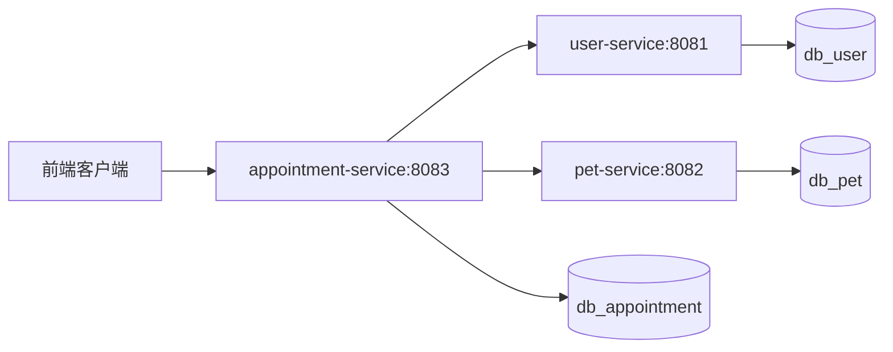

# 宠物医院系统微服务拆分设计
## 拆分总览
将原有单体宠物医院管理系统拆分为3个微服务：
1.user-service 用户服务
2.pet-service 宠物档案服务
3.appointment-service 预约就诊服务

设计约束：每个服务拥有独立数据库，仅读写自身库中的数据表。跨服务关联只存储对方业务ID，通过HTTP API拉取其他服务数据，不建立跨数据库外键。

## 各服务详细定义
### user-service 用户服务
服务端口：8081
独立数据库：db_user
数据表：t_user
核心职责：用户注册登录、宠物主人信息维护、账号基础管理

### pet-service 宠物档案服务
服务端口：8082
独立数据库：db_pet
数据表：t_pet
核心职责：宠物档案新增、信息修改与查询；存储userId关联用户

### appointment-service 预约就诊服务
服务端口：8083
独立数据库：db_appointment
数据表：t_appointment、t_medical_record
核心职责：预约提交、病历记录管理；存储userId、petId，需要用户和宠物信息时调用外部服务接口

## 服务调用关系
1. 创建预约时，appointment-service 调用 user-service 校验用户，调用 pet-service 校验宠物档案
2. 查询预约详情时，appointment-service 根据保存的ID，远程获取用户名称、宠物信息用于展示
3. user-service 和 pet-service 之间不存在直接调用

## 架构图

## 设计结论
按照业务领域边界完成服务解耦，三个服务独立部署、数据隔离。跨服务交互依靠接口调用，避免紧耦合，满足微服务拆分规范。
